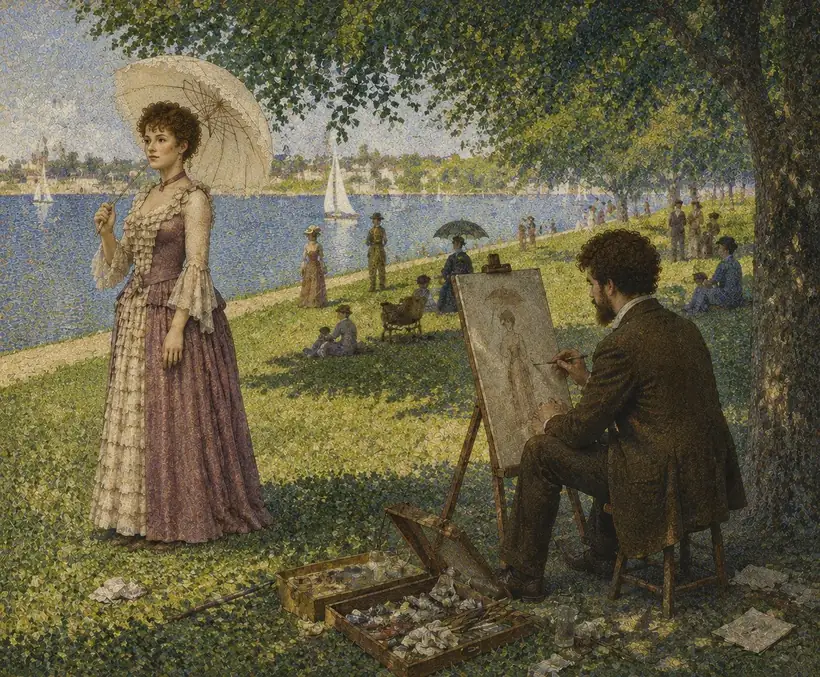
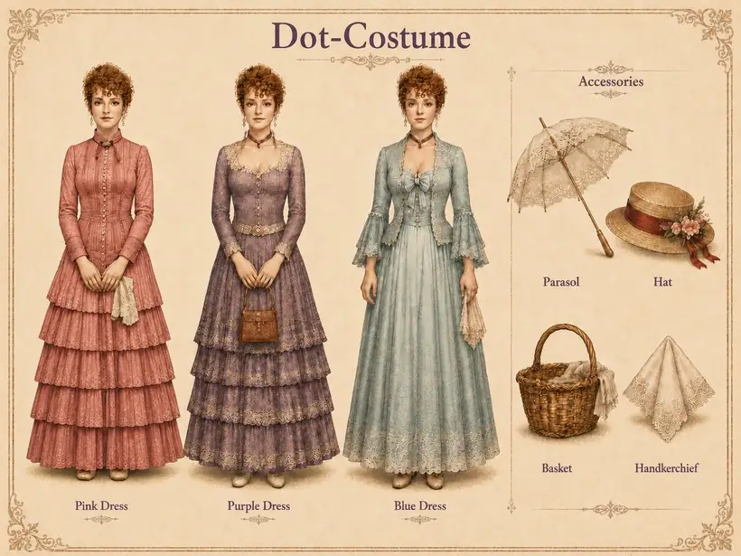

# Ziyin (Zoey) Yu

### Creative Portfolio

*Interactive Narrative · Visual Storytelling · Cross-Media Adaptation · Film & Theatre*

**[Explore my portfolio website](https://zoeyjoy0426-sys.github.io/Interactive-Script/)** · **[Experience Dot by Dot](http://ganmsm.cn/0926/1/0/George.html)**

<picture>
  <source srcset="docs/cover.avif" type="image/avif">
  
</picture>

*Selected visual from Dot by Dot · 2026*

---

## Featured project · Dot by Dot

An interactive graphic-script adaptation of *Sunday in the Park with George*, exploring how theatrical narrative, visual composition, character relationships and audience engagement can be reimagined through branching digital storytelling.

Created as a practice-based MSc project at the **University of Edinburgh**, awarded **73% (Distinction)**.

**[View the complete artwork and visual gallery](https://zoeyjoy0426-sys.github.io/Interactive-Script/)**

## Visual practice

| Character & costume studies | Narrative illustrations |
|:---:|:---:|
|  |  |
| Character turnarounds · Costume development | Scene composition · Illustrated storytelling |

## About

I am a creative practitioner and researcher working across theatre, film, visual culture and digital interaction.

**Education**

- MSc Intermediality: Literature, Film and the Arts in Dialogue — University of Edinburgh (2025–2026)
- BA Drama, Film & Television Literature — Communication University of Zhejiang (2020–2024)

**Areas of Practice:** Interactive Narrative · Visual Storytelling · Cross-Media Adaptation · Film & Theatre

---

Portfolio website: `docs/index.html` · Original interactive script export: `index.html.html`.
